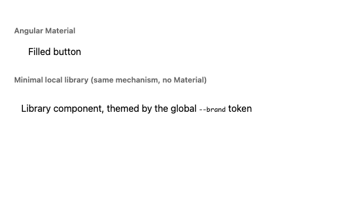
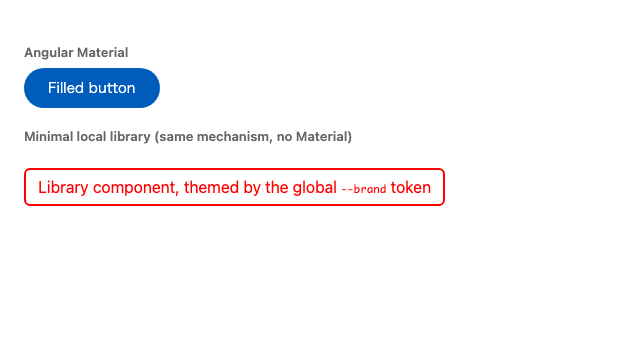

# `provideCssVarNamespacing()` breaks third-party library styling

Angular 22.1.0 / Angular Material 22 / CLI 22.1.2 / Node 22.22.3, verified in Chrome 150.

## Summary

Enabling `provideCssVarNamespacing()` in an application silently breaks every third-party
library whose component styles reference CSS custom properties that are defined in a global
stylesheet, which is the standard way libraries expose theming.

**Angular Material is completely unstyled.** A `<button matButton="filled">` loses its fill,
its label colour and its shape.

Neither party can fix this from where they stand. The consuming application cannot edit the
library's styles, and the library cannot know whether a future consumer will enable
namespacing.

## Why it happens

The compiler rewrites custom property references inside a component's `styles`
(`packages/compiler/src/render3/view/compiler.ts:272` →
`namespaceCssVariables`), unconditionally. Global stylesheets are explicitly out of scope and
are never rewritten.

For a library published with partial compilation this rewrite does not happen at publish
time. It happens at the **consumer's** build, using the **consumer's** namespace, because
`PartialComponentLinkerVersion1.linkPartialDeclaration` re-runs `parseTemplate` and
`compileComponentFromMetadata`.

So the definitions stay `--mat-sys-primary` while every reference becomes
`--<consumer-namespace>_mat-sys-primary`, and nothing resolves.

## Reproduction

```sh
npm install
npx ng build ui                                # build the local library (partial compilation)
npx ng build --configuration development
npx http-server dist/cssvar-global-token-repro/browser
```

Toggle the feature by commenting out `provideCssVarNamespacing('repro')` in
`src/app/app.config.ts` and rebuilding.

The app contains two cases, both of which are third-party-library scenarios:

- **Angular Material**: `@angular/material` 22 with the prebuilt `azure-blue` theme and a
  plain `<button matButton="filled">`.
- **`projects/ui`**: a minimal local library, built with `ng build ui`, whose component
  styles reference `--brand`, which `src/styles.css` defines globally. Included to show the
  mechanism without Material's size.

## Observed

Angular Material filled button, computed styles:

| property | namespacing ON | namespacing OFF |
| --- | --- | --- |
| `background-color` | `rgba(0, 0, 0, 0)` | `rgb(0, 92, 187)` |
| `color` | `rgb(0, 0, 0)` | `rgb(255, 255, 255)` |
| `border-radius` | `0px` | `9999px` |

Local library component:

| property | namespacing ON | namespacing OFF |
| --- | --- | --- |
| `color` | `rgb(0, 0, 0)` | `rgb(255, 0, 0)` |
| `border-color` | `rgb(0, 0, 0)` | `rgb(255, 0, 0)` |




## Evidence

Material defines its tokens globally and references them from component styles:

```
$ grep -o -- "--mat-sys-[a-z-]*:" node_modules/@angular/material/prebuilt-themes/azure-blue.css | sort -u | wc -l
157                                   # tokens defined in the global stylesheet

$ grep -o -- "var(--mat-" node_modules/@angular/material/fesm2022/button.mjs | wc -l
832                                   # references inside the library's component styles
```

At runtime, with `provideCssVarNamespacing('repro')`:

```js
getComputedStyle(document.documentElement).getPropertyValue('--mat-sys-primary')
// "#005cbb"                      <- defined by the global theme, not namespaced

getComputedStyle(document.documentElement).getPropertyValue('--repro_mat-sys-primary')
// ""                             <- what every reference in Material now looks for
```

The local library shows the same thing in the build output. As published, before the
consumer's build:

```
$ grep -o -- "var(--brand)\|ngDeclareComponent" dist/ui/fesm2022/ui.mjs
ngDeclareComponent
var(--brand)
```

After the consumer's build:

```
#lib[_ngcontent-%COMP%]{color:var(--%NS%brand)}
```

while the global stylesheet keeps the plain name:

```
$ grep -o -- "--[a-zA-Z%-]*" dist/cssvar-global-token-repro/browser/styles.css
--brand
```

## Note on `--global--`

`--global--foo` is the designed opt-out and does work, but only in source the author
controls. A library would have to spell every token `--global--mat-sys-…` in its own styles to
protect itself against a decision its consumers make, and libraries published before v22.1
cannot. A consuming application has no way to apply it to a dependency.
